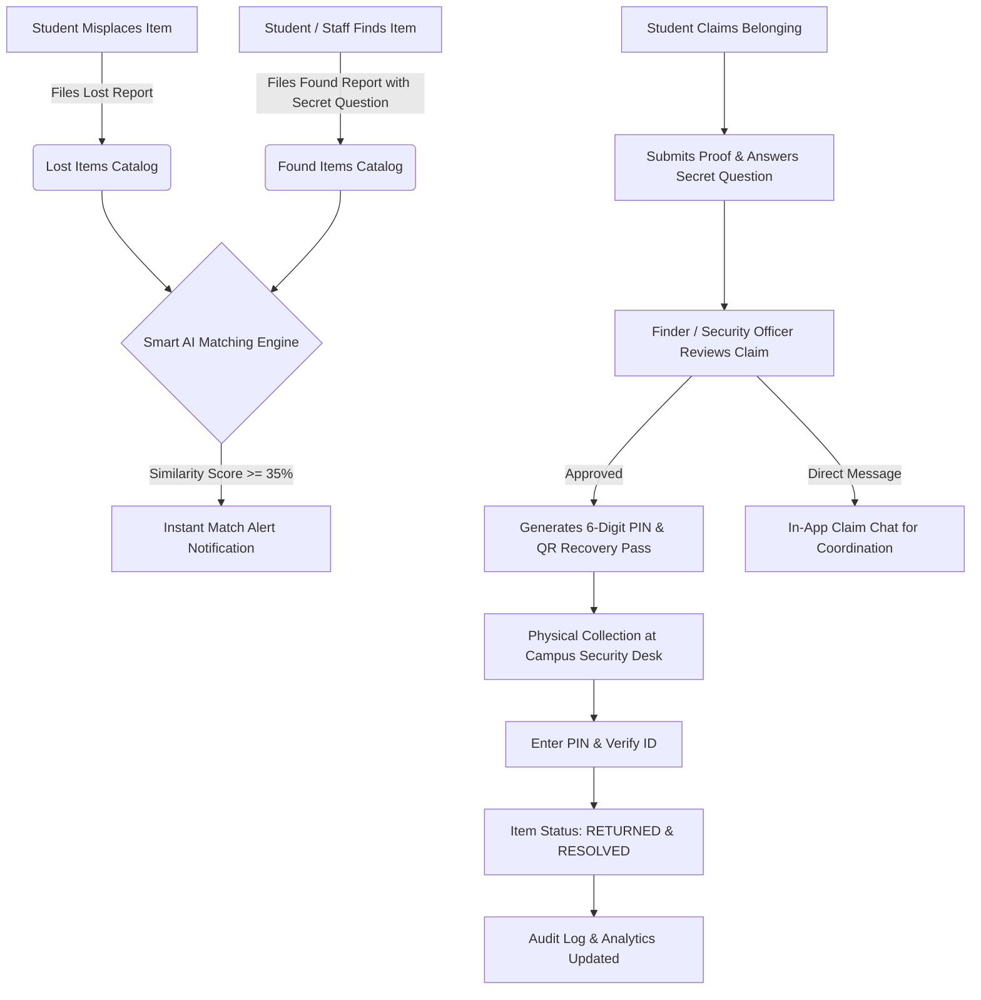

# 🧭 CampusFind - College Lost & Found Portal

> **A modern, intelligent, and fraud-resistant Lost and Found web platform designed specifically for university campuses.**

---

## 📌 Executive Summary

Every semester across university campuses, hundreds of valuable student belongings—such as laptops, wireless earbuds, calculators, smart ID cards, wallets, and keys—are misplaced in libraries, cafeterias, lecture halls, and sports complexes. 

Traditional college lost-and-found systems rely on notice boards, unorganized WhatsApp/Telegram groups, or dusty security desk logbooks where items sit unclaimed for months. Anyone can falsely claim an expensive gadget without verification.

**CampusFind** solves this with a campus-centric web platform featuring:
1. **Automated NLP/Keyword Smart Matching Engine** that instantly cross-references lost and found reports.
2. **Anti-Fraud Ownership Verification** using custom secret questions and proof submissions.
3. **Secure 6-Digit Handover PIN & Scannable QR Claim Passes** for tamper-proof in-person pickups.
4. **Campus Security Locker Depository Management** with real-time audit logging and CSV export.
5. **Interactive Campus Map & Zone Hotspot Visualizer**.

---

## 🚀 Key Features & Innovations

### 1. 🤖 Smart AI / NLP Matching Engine
- Whenever a lost or found item is logged, the matching algorithm computes a **similarity score (0–100%)** analyzing:
  - Category match (Baseline weight)
  - Title & description keyword overlap (stopwords filtered, tokenization)
  - Campus building proximity & zone match (e.g., Central Library, CS Lab)
  - Date proximity (reported within 48 hours / 7 days)
- Users receive real-time **Smart Match Suggestion Alerts** highlighting exact reasons (e.g. `95% Match: Category matched + Shared keywords: airpods, blue case`).

### 2. 🛡️ Anti-Theft Verification & Claim Flow
- Prevents opportunistic theft of high-value items (laptops, phones, AirPods).
- Finders can attach a **Secret Verification Question** (e.g., *"What brand is embossed on the protective case?"* or *"What is written on the back?"*).
- Claimants must provide proof details and answer the secret question.

### 3. 🎫 6-Digit Handover PIN & QR Recovery Pass
- When a claim is approved by the finder or campus security, the system generates a **secure 6-digit Handover PIN** and an official **scannable QR Code Claim Pass**.
- During in-person collection at the Security Desk or hostel, the recipient shows their pass and the custodian enters the PIN to finalize the return.
- Marked officially as **Resolved** with a full audit log.

### 4. 💬 In-App Direct Discussion Threads
- Private, secure messaging between claimant, finder, and security officers directly on the claim record.
- Allows students to coordinate meeting spots and clarify details without publicly broadcasting phone numbers.

### 5. 🗺️ Interactive Campus Map & Hotspot Navigator
- Visual schematic representation of campus zones (Academic, Recreational, Residential, Administrative).
- Real-time lost & found counters for every campus building (Central Library, Turing CS Labs, Cafeteria, Hostels, Sports Arena).

### 6. 🏛️ Campus Security Administration Center
- Real-time KPI dashboard: Total items, Active Lost, In Custody, Reunited count, Return Rate (%).
- **Locker / Bin Depository Manager**: Assign items to specific physical lockers in the Security Office (e.g., `SEC-LOCKER-12`).
- Interactive Category Breakdown Chart (Chart.js).
- Download official campus audit reports in CSV format.

### 7. ⚡ 1-Click Quick Demo Login (Hackathon Judge Mode)
- One-click instant login switcher in the top banner:
  - **Student (Aarav Sharma)**: Reported lost AirPods Pro 2, has active approved claim.
  - **Finder (Priya Patel)**: Found AirPods and keys, reviewed claims.
  - **Campus Security Admin (Officer Rajesh)**: Full custody and locker management access.
  - **Faculty (Prof. Anand Mehta)**: Department staff member.

---

## 🏗️ System Architecture & Workflow



---

## 💻 Tech Stack

- **Backend Framework**: Python 3.13, Flask 3.1.0
- **Database & ORM**: SQLite, Flask-SQLAlchemy 3.1.1, SQLAlchemy 2.0
- **Authentication**: Flask-Login 0.6.3 with PBKDF2 password hashing
- **Frontend / Styling**: Tailwind CSS (CDN), Plus Jakarta Sans font, FontAwesome 6 Free
- **Data Visualization**: Chart.js for campus administrative analytics
- **Utilities**: `qrcode` & Pillow for dynamic QR code claim slip generation

---

## 🛠️ Quick Start & Installation

### 1. Prerequisites
Ensure Python 3.10+ is installed on your machine.

### 2. Install Dependencies
```bash
pip install -r requirements.txt
```

### 3. Run the Application
```bash
python app.py
```

The database will be automatically initialized and pre-seeded with realistic sample items, campus locations, and test accounts on first launch!

Open your browser and navigate to:
```
http://localhost:5000
```

---

## 👥 Pre-Configured Demo Accounts

| Role | Name | Email | Password | Pre-seeded Activity |
|---|---|---|---|---|
| **Student** | Aarav Sharma | `aarav.sharma@apexuni.edu` | `student123` | Reported lost AirPods Pro 2; Claim #1 approved with PIN `749201` |
| **Finder** | Priya Patel | `priya.patel@apexuni.edu` | `student123` | Found AirPods and keys; Deposited in Security Locker |
| **Security Admin** | Officer Rajesh Kumar | `admin@apexuni.edu` | `admin123` | Campus security chief; Full dashboard access & locker inventory |
| **Faculty** | Prof. Anand Mehta | `prof.mehta@apexuni.edu` | `faculty123` | Physics Dept; Found Casio fx-991CW calculator |

> **Pro Tip**: You can also switch between any of these accounts in 1 click using the top demo ribbon!

---

## 🧪 Automated Test Suite

A complete test suite covering database seeding, catalog search/filters, smart similarity matching, authentication, QR passes, and CSV export is included:

```bash
python test_app.py
```

Expected Output:
```
Ran 9 tests in 0.393s
OK
```

---

## 📜 License
Developed for College Innovation Hackathon. Open source for academic institutions.
